I build automations, API integrations and AI agents for business operations. Most of my work connects CRMs, databases, LLMs and third-party APIs, and keeps those workflows running in production.

[Email](mailto:lucasgdeveloper@gmail.com) · [LinkedIn](https://www.linkedin.com/in/devlucasgonz/)

### Projects

- **Sonara**: recruitment engine using LLM-based candidate profiling and vector search. 3rd place, Hack-Nation Global AI Hackathon.
- **Cashew Care**: IoT and AI platform for real-time crop diagnostics. 3rd place, Huawei Developer Competition LATAM.
- **PlantAI**: crop diagnostics platform using computer vision on openEuler. Huawei ICT Competition, national phase.

### Curiosities

- I won 2nd Prize at the Huawei ICT Competition Global Final, Computing Track (Shenzhen, 2025)
- In my free time I like to explore new AI features, play chess and cook

### Tools

Python · TypeScript · Node.js · PostgreSQL · Supabase · n8n · Make · Zapier · Claude API · Docker
